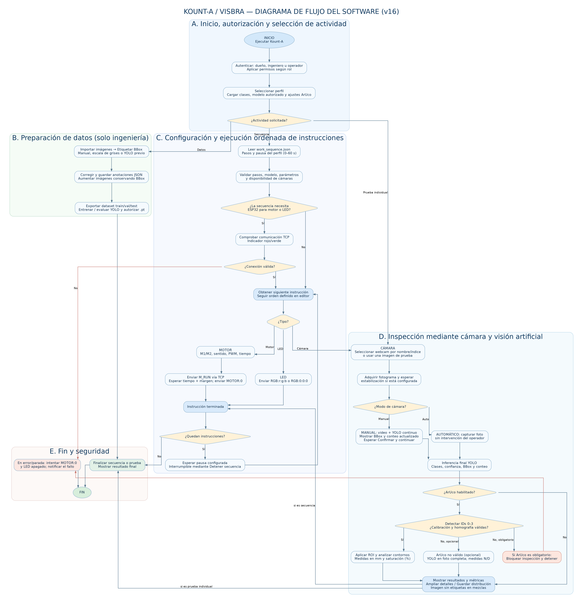
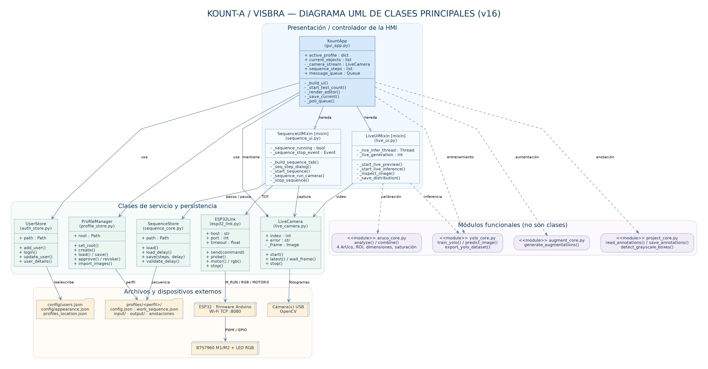

<div align="center">


# Kount-A / Visbra

**Software de visión artificial para inspección, identificación y conteo de componentes**

Python · OpenCV · YOLO · ArUco · ESP32

</div>

## Vista general del sistema

Los siguientes diagramas presentan, de manera visual, el funcionamiento del sistema y la organización de sus módulos. **Haz clic en cada diagrama para abrirlo en tamaño completo.**

<table>
  <tr>
    <th width="50%">Diagrama de flujo integral</th>
    <th width="50%">Diagrama UML de clases</th>
  </tr>
  <tr>
    <td valign="top" align="center">
      <a href="docs/diagramas/01_flujo_integral_KountA_v16.svg">
        
      </a>
    </td>
    <td valign="top" align="center">
      <a href="docs/diagramas/02_uml_clases_Visbra_v16.svg">
        
      </a>
    </td>
  </tr>
  <tr>
    <td>Inicio de sesión, perfiles, secuencias, adquisición, procesamiento, detección YOLO, mediciones ArUco y resultados.</td>
    <td>Clases de interfaz, módulos de cámara, almacenamiento, detección, perfiles, secuencias y comunicación ESP32.</td>
  </tr>
  <tr>
    <td align="center"><a href="docs/diagramas/01_flujo_integral_KountA_v16.pdf">Ver PDF</a> · <a href="docs/diagramas/01_flujo_integral_KountA_v16.svg">Ampliar SVG</a></td>
    <td align="center"><a href="docs/diagramas/02_uml_clases_Visbra_v16.pdf">Ver PDF</a> · <a href="docs/diagramas/02_uml_clases_Visbra_v16.svg">Ampliar SVG</a></td>
  </tr>
</table>

## Diagramas en detalle

### Flujo de funcionamiento

[](docs/diagramas/01_flujo_integral_KountA_v16.svg)

### Arquitectura UML

[](docs/diagramas/02_uml_clases_Visbra_v16.svg)

---

Visbra integra adquisición y procesamiento de imágenes, detección y conteo mediante YOLO, referencias espaciales y dimensionales con ArUco, interfaz gráfica y comunicación con el sistema embebido del prototipo **Kount-A**.

## Primera ejecución: cuenta del dueño y perfiles

Al iniciar Visbra por primera vez, **no necesitas crear manualmente las carpetas ni editar archivos JSON**.

1. **Instala las dependencias** desde la carpeta principal del proyecto y ejecuta la interfaz:

   ```bat
   py -m pip install -r requirements.txt
   py -m src.gui_app
   ```

2. **Crea la cuenta del dueño.** Si todavía no hay usuarios registrados, la pantalla inicial mostrará **«Crear cuenta del dueño»**. Escribe un nombre de usuario de 3 a 32 caracteres (letras, números, `_`, `.` o `-`) y una contraseña de **al menos 8 caracteres**. La aplicación guardará la cuenta localmente en `config/users.json` con una derivación criptográfica de la contraseña, no la contraseña en texto plano.
3. **Abre el espacio de trabajo.** Visbra crea automáticamente `profiles/` en la raíz del proyecto y, si no encuentra perfiles, genera uno inicial llamado **Tornillería**, con clases de ejemplo y carpetas de entrada, anotaciones, resultados y modelos. Este perfil comienza en estado *desarrollo*: no incluye un modelo YOLO entrenado ni queda autorizado automáticamente para producción.
4. **Configura tus perfiles de trabajo.** Desde **1 · Perfiles** puedes crear perfiles adicionales y administrar sus clases. Si ya tienes perfiles en otra ubicación, usa **«Explorar perfiles…»** para seleccionar su carpeta; no se copiarán ni sobrescribirán automáticamente. Una carpeta externa vacía no recibe el perfil de ejemplo.
5. **Administra usuarios y autorizaciones.** La cuenta **dueño** puede gestionar usuarios en **8 · Usuarios** y autorizar modelos para los perfiles. Los ingenieros configuran y entrenan; los operadores solo utilizan perfiles y modelos autorizados.

> **Importante:** «Dueño» es un **rol de usuario**, no una clase ni un perfil de producto. No hace falta crear un «perfil del dueño». Los archivos de usuarios, perfiles, contraseñas y configuraciones locales no se incluyen en este repositorio público: se generan o configuran en tu instalación y no deben subirse a GitHub.

### Tres grandes etapas

1. **Desarrollo inicial:** base de aumento de datos, bounding boxes, parámetros por clase y entrenamiento de clasificación (v4–v10).
2. **Detección y entrenamiento:** detector multiobjeto, herramientas de etiquetado y transición a YOLO (v11–v14).
3. **Integración del sistema:** gestión de perfiles, ArUco, interfaces, cámara en vivo, comunicación ESP32 y secuencias (v15–v16).

### Versiones

Las versiones se identifican con etiquetas del tipo `v1.4.0`, `v2.11.0` y `v3.16.4`. **El primer número indica la etapa**, el segundo corresponde al número original de Visbra y el tercero distingue una revisión puntual documentada. Esta convención es propia del proyecto, no SemVer estándar.

Los commits y las etiquetas se reconstruyeron a partir de entregas ZIP y no representan fechas originales de programación. No se dispone de un paquete v7 y la designación v4 para la carpeta inicial es provisional.

### Ejecutar la última entrega

Consulta su `README.md` y `requirements.txt` antes de instalar. Se requiere Python y las bibliotecas de visión/IA correspondientes; para actuadores, el firmware ESP32 debe estar instalado aparte. Los conjuntos de datos, los perfiles, los modelos y las configuraciones personales no se incluyen por privacidad y tamaño.

### Publicación y autoría

El proyecto pertenece a su equipo desarrollador. La publicación pública no concede por sí misma permiso de redistribución de código ajeno. No se ha definido una licencia en este paquete de preparación.


### Documentación técnica

- [Resumen de los tres avances](docs/historial/AVANCES.md)
- [Diagrama de flujo integral (PDF)](docs/diagramas/01_flujo_integral_KountA_v16.pdf)
- [Diagrama UML de clases (PDF)](docs/diagramas/02_uml_clases_Visbra_v16.pdf)
- [Versiones y trazabilidad](docs/historial/VERSIONES_Y_TRAZABILIDAD.md)
- [Historial de cambios](docs/historial/CHANGELOG.md)
- [Auditoría de rutas y privacidad](docs/historial/AUDITORIA_RUTAS_Y_PRIVACIDAD.md)

**Estado de publicación:** `historial-visbra` es la rama predeterminada y conserva el código y la documentación actuales. Las 19 etiquetas permiten consultar versiones históricas independientes; no se reescribieron. La antigua rama `main` permanece como respaldo de la documentación inicial, sin ser necesaria para utilizar el programa. Los cambios de documentación posteriores a `v3.16.4` no alteran aquella etiqueta.
